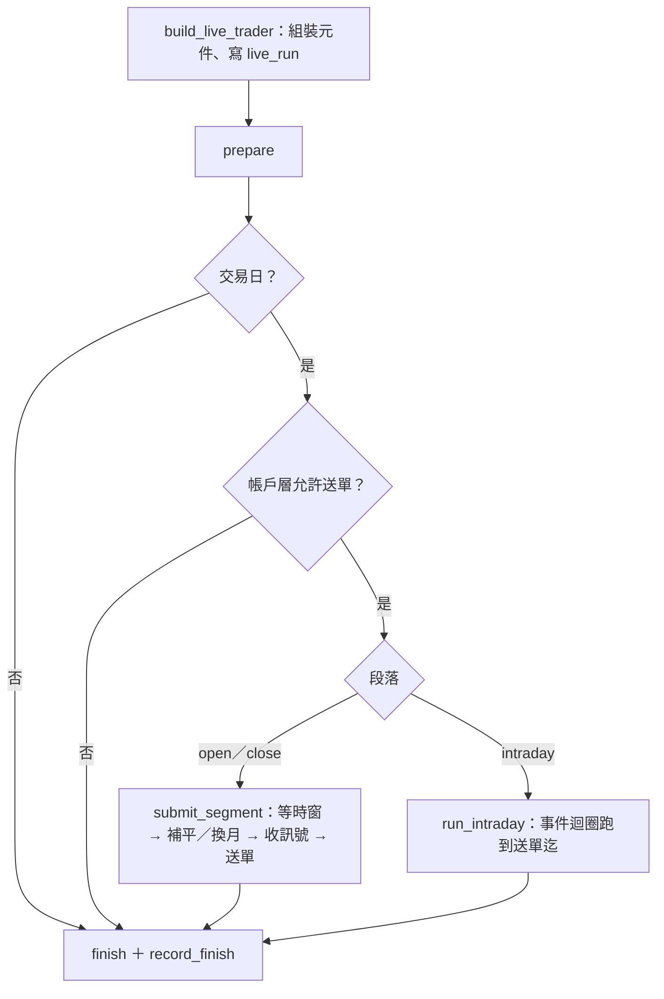

# 實盤引擎架構

> 本文件說明實盤引擎（`core/live/`、`core/broker/`）的現行架構：一個段落怎麼跑完、一張委託經過哪些關卡、
> 交易模式怎麼降級與恢復、委託與成交怎麼記帳、多策略怎麼分帳與對帳，以及盤後與 parity 做什麼。
> 相關文件不重複的部分請直接看：
>
> - 委託價格類型、ROD／IOC 怎麼由 `MARKET`／`LIMIT` 換算出來：[實盤執行層](execution-layer.md)
> - 命令列、排程、退出碼、存活監控、kill switch、以券商部位重建的操作步驟：[實盤部署與排程](../deployment/live-deployment.md)
> - 上正式環境前的逐項檢查：[股票線](production-checklist-stock.md)、[期貨線](production-checklist-futures.md)小額上線檢查表
> - 策略端要宣告的實盤欄位（`live_ready`、`execution_schedule`、`live_execution` 等）：[策略撰寫指南](../../strategies/README.md)

---

## 一、元件地圖

引擎本體 `LiveTrader`（`core/live/trader.py`）**市場無關、沒有子類**：程式碼裡不出現任何市場或商品字樣，
市場語意（資料源、部位管理、執行層、段落時窗、帳務查詢）全部由 `core/live/factory.py` 依
`(market, instrument_type)` 分派後注入。`scripts/check_layer_deps.py` 會擋住市場字樣漏進引擎。

元件分成「帳戶級單例」與「逐策略一份」兩種，這條線是整個多策略設計的骨幹：

| 範圍 | 元件 | 為什麼是這個範圍 |
|------|------|------------------|
| 單例 | 券商閘道（`ShioajiBroker`）、限流器（`RateLimiter`） | 券商的呼叫額度與回報 callback 都是帳戶級的；拆成多份會互相不知情 |
| 單例 | 委託管理 `OrderManager`（`core/live/oms/order_manager.py`） | 回報 callback 是 session 級；多策略的歸屬靠每張委託上的 `strategy_name`，不靠多個 OMS |
| 單例 | 事前風控 `PreTradeRiskManager`、交易模式 `TradingModeState`（`core/live/risk/`） | 「現在能不能送單」只能有一個持有者 |
| 單例 | 資金分配 `CapitalAllocator`、歸屬帳 `PositionAttributionLedger`、跨策略守門、對帳器 | 它們回答的都是「整個帳戶」的問題 |
| 逐策略 | `StrategyContext`：帳戶、`PositionManager`、資料源、成本模型、執行層、金額換算 | 共用一份的話，兩支策略的部位與損益會混在一起，而合計仍然正確——對帳看不出來 |

`build_live_trader()` 收的是**策略清單**；清單只有一支時行為與單策略完全相同，多策略不是另一條程式路徑。
策略名是歸屬鏈的鍵（`live_order.strategy_name`、`live_position_lot`），重名直接拒絕組裝。

狀態全部存在 `data/db/tw_trading.db`（`core/dao/tw/live_trade_dao.py`），段落之間靠它延續：

| 表 | 存什麼 |
|----|--------|
| `live_run` | 每次啟動一列：段落、策略、環境、結束時間、結束原因、帳戶層交易模式 |
| `live_order`／`live_fill` | 委託與成交明細（兩條線共用一張成交表） |
| `live_position_lot` | 部位歸屬帳（逐策略、逐筆 lot） |
| `live_strategy_mode` | 策略層交易模式 |
| `live_pending_action` | 跨日待辦（次日開盤段補平） |
| `live_risk_event` | 所有風控、守門、對帳、回報異常事件；類別名登錄在 `core/live/risk/event_categories.py` |
| `live_position_snapshot`／帳務快照 | 每次對帳寫下的三方部位（策略層、帳戶合計、券商）與各策略帳務 |
| `live_parity_diff` | 訊號 parity 的逐筆差異 |

---

## 二、一個段落的生命週期

實盤不是常駐服務，而是每個段落各啟動一個行程、跑完就結束（排程見[實盤部署與排程](../deployment/live-deployment.md)）。
股票線與期貨線是**兩個行程、同一個帳號**。

### 段落與時窗

每個段落有三個時點（`core/market/segment.py` 的 `SegmentWindow`）：**送單起**、**送單迄**、**收線**。
送單時限與收線分開，是因為集合競價送出的 ROD 委託要留在場上等撮合，成交回報在撮合之後才進來；
送完單就關連線，當日成交明細會有空窗，對帳會在錯的時點判定不一致。
時點是市場特性，寫在 `core/market/tw/segment_schedule.py`，TICK 回測也讀同一張表。

| 段落（`--phase`） | 引擎入口 | 台股時窗（起／迄／收線） | 台期貨時窗 |
|-------------------|----------|--------------------------|------------|
| `open` | `LiveTrader.run(AT_OPEN)` | 08:30／08:59／09:05 | 08:45／08:59／09:05 |
| `intraday` | `LiveTrader.run(IMMEDIATE)` | 09:05／13:18／13:19 | 無 |
| `close` | `LiveTrader.run(AT_CLOSE)` | 13:25／13:29／13:35 | 13:30／13:44／13:50 |
| `after_close` | `LiveTrader.run_after_close()` | 不送單 | 不送單 |
| `parity` | `LiveTrader.run_parity()` | 不連券商、不送單 | 同左 |

- 台股尾盤段 **13:25 才送單**：更早送出的限價單會在逐筆交易時段成交，成交價不是收盤價，與回測假設對不上而且看起來完全正常。
- 盤中段夾在開盤段收線（09:05）與尾盤段啟動之間：同一帳號的委託回報會推給每一條連線，兩個行程同時在場上時各自都會收到對方的回報。
- 一行指令載入多支策略時，`_merge_schedules()` 對同一段落取**交集**；台股與期貨的尾盤時窗沒有交集，合併時直接拒絕（要分開排程），不湊一個「開始晚於結束」的窗。

### 送單段落（`open`／`close`／`intraday`）



`prepare()` 的順序固定，每一步都有理由：

1. 連線券商，替沒有標的池的策略補上預設標的（要靠券商查的標的池，例如期貨掛牌月份，組裝時還補不到）；補完仍為空就寫 `UNIVERSE_EMPTY` 並推播。
2. 把上次沒有結束紀錄的 `live_run` 標成崩潰並推播——**要排在讀模式之前**，否則上次崩潰那一列的降級狀態會被跳過。
3. 讀回交易模式；帶 `--resume-trading` 時在讀回之後恢復（見第四節）。
4. `verify_strategies()`（`core/live/strategy_guard.py`）：啟動守門，一次列出所有不合格的策略。擋的是「不報錯、只讓結果安靜地不同」的設定：沒宣告 `live_ready`／`execution_schedule`／`live_execution`，或段落安排與 `allow_day_trade` 推出的開平倉順序矛盾。
5. 判定交易日（各資料源各判一次，任一休市就整段不送單；判不出來直接拋出）與歷史資料新鮮度。
6. `OrderManager.recover()` 接管當日未終結的委託（第五節），並以紀錄庫裡當日已送出的開倉單金額起算風控的單日累計（三個段落是三個行程，每個都從 0 起算的話，單日累計上限只管得住單一段落）；接著 `FillBackfiller` 依 `live_fill` 回填接管回來的委託已有的成交（第九節的同一支）。**回填一定在重建之前**：順序反了，送單後崩潰才成交的那口會被下一步收進 `__unattributed__`。
7. 以 `live_position_lot` 重建各策略帳戶，券商多出來的量收進 `__unattributed__` 並寫 `POSITION_UNATTRIBUTED`（CRITICAL；第六節）；重設各策略本地餘額為「額度 − 持倉金額」。
8. 刷新帳務快照與資金分配；正式環境檢查額度總量（Σ 額度 ≤ 總權益 × 0.95，不滿足拒絕啟動），模擬環境略過。
9. 當日虧損檢查（第四節）。
10. 對帳（第七節）。

送單流程（`submit_segment()`）：等到送單起 → **開盤段先執行到期的跨日待辦**（補平前一天沒成交的出場單）→
**尾盤段先換月**（策略看到的持倉才與它要交易的契約一致）→ 逐策略收訊號 → 跨策略檢查 → `dispatch()` 逐單送出（第三節）。換月平倉腿只成交一部分（IOC 成交幾口後被取消）時寫 `ROLL_PARTIAL`（CRITICAL），開倉腿改送已平的口數補回曝險，沒平的次日再換；完全沒成交才是 `ROLL_ABANDONED`（WARN）。

收尾（`finish()`，在 `finally` 裡一定執行）：

| 情況 | 順序 | 理由 |
|------|------|------|
| 正常結束 | 收回報到收線 → 撤未成交單 → 再收 5 秒撤單回報 | 集合競價的 ROD 單要留到撮合後；送完就撤，集合競價一張都不可能成交 |
| 例外或 SIGTERM | 立刻撤單 → 收回報到收線 | 引擎已不在可控狀態，留在場上的單沒人處理 |

之後釋放所有資金保留、寫各策略帳務快照、關閉連線，最後 `record_finish()` 把結束原因與帳戶層模式寫進 `live_run`。
結束原因的判定順序與入口的退出碼一致（例外 → kill switch → 對帳不一致 → 帳戶層非 NORMAL → 正常），
存活監控只看這一欄決定要不要推播。

SIGTERM 由 `core/live/termination.py` 轉成 `LiveTerminated`（繼承 `BaseException`）：
引擎到處有「一張單失敗不拖垮其他單」的 `except Exception`，若繼承 `Exception`，訊號落在送單途中會被當成送單失敗吞掉、接著送下一張。
收尾期間再收到的 SIGTERM 一律忽略。

所有等待迴圈（等時窗、等回報、換月等成交、盤中迴圈）都有**獨立於時鐘的保險絲**：另外累計實際睡過的秒數或心跳次數，
時鐘卡住或倒退時仍會跳出並記 error，不讓段落永不結束、擋住下一個行程。
**等送單時窗逾時不是「記一行就繼續」**：寫 `SUBMIT_WINDOW_MISSED`（CRITICAL）並推播，整段放棄送單（補平、換月、策略訊號都不送）；`dispatch()` 自己也擋時窗之外的委託——還沒到 `submit_start` 與已過 `submit_end` 都不送。提早送出的尾盤單會在逐筆交易時段以掛漲停的限價成交，與回測的收盤價假設分岔，而且看起來完全正常。

---

## 三、委託路徑

```
策略鉤子（停損 → 平倉、開倉；先後依 allow_day_trade）
  → 前處理：方向白名單 → 成本模型補欄位（台股空單的放空管道與當沖旗標）→ 決定性排序 → 持倉檔數上限（只擋開倉）
  → 跨策略守門（同標的只允許一個持有者）
  → 批次曝險：策略層 → 帳戶層（超額截斷後面的單，不整批拒）
  → dispatch() 逐單：
       已過送單迄？ → 保證金閘（期貨開倉）→ 資金保留（只有開倉）
       → 執行層（記下決策價、改寫價格類型與委託價）→ 事前風控 → OMS 先寫 DB 再送券商 → 消化一次回報
```

| 關卡 | 位置 | 擋下時 |
|------|------|--------|
| 持倉檔數上限 | `LiveTrader._apply_max_holdings()` | 寫 `MAX_HOLDINGS`；未終結的委託也佔名額，否則一批 8 張同時送出時全部放行 |
| 跨策略守門 | `core/live/attribution/conflict_guard.py` | 寫 `CROSS_STRATEGY_BLOCKED`；**平倉單一律放行** |
| 批次曝險 | `PreTradeRiskManager.check_batch()` | 寫 `BATCH_EXPOSURE`；平倉單放行且不計入曝險；帳戶層事件記在 `__account__` 名下 |
| 保證金閘 | `core/live/risk/margin_gate.py` | 寫 `MARGIN_INSUFFICIENT`；同一批開倉單逐張累計同一份可用保證金；平倉不檢查 |
| 資金保留 | `CapitalAllocator.reserve()` | 寫 `CAPITAL_EXHAUSTED`；以決策價計算，出場不保留（出場是釋放資金） |
| 執行層 | `core/live/execution/` | 寫 `EXECUTION_UNAVAILABLE`；細節見[實盤執行層](execution-layer.md) |
| 事前風控 | `PreTradeRiskManager.check()` | 寫該條規則的類別（見下表） |

**守門要在批次曝險之前**（被擋的單不該佔曝險額度），**資金保留要在風控之前**（風控算的是拿得到的金額）。
逐筆盤中段落與日頻段落**走同一條**（`_submit_one_quote()` 重用 `apply_cross_checks()` 與 `dispatch()`），另寫一份必然漂移。

### 事前風控

`PreTradeRiskManager.check()` 先看「能不能送」、再看「該不該送」：

| 順序 | 規則（類別） | 適用 | 說明 |
|------|--------------|------|------|
| 1 | `KILL_SWITCH` | 全部 | **每張單送出前**都檢查檔案；成立時帳戶層降到 `HALTED`。檔案系統查不了時當成生效 |
| 2 | `MODE_HALTED`／`MODE_REDUCE_ONLY` | 平倉／開倉 | 依該策略的有效交易模式 |
| 3 | `SINGLE_ORDER_AMOUNT`、`DAILY_AMOUNT`、`VOLUME_CAP` | 只管開倉 | 出場是釋放曝險，套用的話持倉漲價後就平不掉 |
| 4 | `PRICE_LIMIT`、`PRICE_DEVIATION` | 全部 | 比的是**決策價**對漲跌停與市場基準價（本段落餵給策略的報價，取不到退回合約參考價，都沒有時放行並寫 `REFERENCE_PRICE_MISSING`） |
| 5 | `ORDER_RATE` | 全部 | 超過每分鐘上限時拒單**並**把該策略降到 `REDUCE_ONLY`——迴圈 bug 不會因為被拒一次就停 |

門檻是**每支策略一份**（`core/models/risk_config.py`，frozen），股票與期貨各一個類別、同性質的欄位同名：

| | `StockRiskConfig` | `FuturesRiskConfig` |
|---|---|---|
| `single_order_ratio`／`daily_ratio` | 委託金額（價 × 股數）÷ 額度 | 原始保證金 ÷ 額度 |
| `max_order_volume` | 張（預設 50） | 口（預設 5） |
| 批次曝險 | `total_exposure_ratio`、`single_symbol_exposure_ratio`（持倉金額） | `max_leverage`：總契約價值 ÷ 額度（預設 4 倍） |
| 共用 | `price_deviation_ratio`、`max_orders_per_minute`、`daily_loss_ratio` | 同左 |

比率一律以策略的實盤額度（`live_capital`）為基準。期貨分成保證金與契約價值兩種金額：單筆與當日上限、資金保留、已用額度
看的是**實際占用的錢**（保證金）；批次曝險看的是**實際承擔的風險**（契約價值）。以契約價值計單筆上限的話一口台指期就是千萬級，
任何合理的額度都送不出去；兩者都不乘乘數的話一口只算幾萬元，金額類上限等於沒有作用。

門檻分三層，由寬到嚴：
1. **全域上限**（各類別的 `CAPS`，程式寫死）：建立設定時就比對，超過直接拋錯。改它要有人明確決定並留下 commit。
2. **策略宣告**（`self.live_risk_config = FuturesRiskConfig(max_leverage=3.0)`）：只填要改的欄位，沒宣告就用該市場預設值。
   類別要與策略的市場相符，宣告錯市場在組裝時就報錯。
3. **部署設定**（`deploy/live_risk.toml`，進版控）：以策略類別名分段，**只能收緊**；寫了比策略宣告更寬的值、
   不存在的欄位或格式錯，啟動時當場報錯。`[account]` 段設帳戶層的 `AccountRiskConfig`（策略類別不能設）。

實際生效的值（帳戶層一份、各策略各一份）寫進 `live_run.risk_config_json`。帳戶層的批次曝險依市場分組、各用該市場的預設上限，
不讀策略宣告。帳戶總曝險沒有獨立欄位，而是由「啟動時 Σ 額度 ≤ 總權益 × `CAPITAL_SAFETY_RATIO`」與
「各股票策略曝險 ≤ 自己額度 × `total_exposure_ratio`」間接保證。

### 出場單沒送出時

段落收訊號產生的平倉／停損單若在送出前被擋下（已過時限、執行層換不出、風控擋下、送單失敗），
`_record_unsent_exit()` 當場寫一筆次日到期的 `live_pending_action` 與 `UNSENT_EXIT`（CRITICAL）並推播，
與盤後「平倉未成交必須補」走同一條補平路。**kill switch 與 `HALTED` 擋下的除外**：那是「現在什麼都不動」的決定。
開倉單未送出一律放棄；時窗之外被丟掉的開倉單寫 `SUBMIT_DEADLINE_PASSED`（WARN），parity 歸到執行面而不是快照口徑。補平、換月兩腿、當沖回補與逐筆路徑各有自己的失敗處理，不重複排待辦。
**出場單送出前先扣掉同一個部位已在場上、尚未撮合的出場量**（`EXIT_TRUNCATED`，WARN）：開盤段先送的補平單 09:00 才撮合，策略接著讀仍持有的帳戶再送一張平倉，兩張同時撮合就是超賣；扣到 0 的不送也不排待辦，在途那張沒成交時由盤後殘量處理替它排。

次日開盤段執行待辦時，**數量截到目前實際持有量**（遲到的成交、人工平倉、重建都會讓部位變），持有量為 0 就標完成不送；
送不出去就把到期日滾到次日並再推播一次。

---

## 四、交易模式

`core/live/risk/trading_mode.py`：三個值、**只能單向降級、恢復一律人工**——會自動降級的條件多半是偵測不完整的異常，自動恢復等於賭它已經好了。

| 模式 | 開倉 | 平倉／停損 | 用在 |
|------|------|------------|------|
| `NORMAL` | ✓ | ✓ | 正常 |
| `REDUCE_ONLY` | ✗ | ✓ | 行情中斷、虧損上限、對帳不一致、下單頻率超限、接管時比對不明 |
| `HALTED` | ✗ | ✗ | kill switch、單一策略鉤子拋例外（部位或策略本身不可信） |

`HALTED` 連平倉都不送，部位會失去停損能力，所以只用在「連部位都不可信」的情況；行情中斷這類只降到 `REDUCE_ONLY`。

帳戶層一個模式、每支策略各一個，**有效模式取兩者較嚴格者**。兩層都即時落地（帳戶層寫 `live_run.account_mode`、策略層寫 `live_strategy_mode`），
因為日頻的三個段落是三個行程：不落地的話，開盤段降級的策略到尾盤段重啟時會靜默回到 `NORMAL`。
讀回來的降級也會在本次 `live_run` 當場寫一次，否則本行程崩潰後下一段讀到的是插入時的 `NORMAL`。

**只有風控改模式**。對帳器、OMS、盤中事件迴圈都只送降級事件（`on_degrade_event()`），不自己切換。

| 觸發 | 來源 | 範圍 → 目標 |
|------|------|-------------|
| kill switch 檔案存在 | 送單前的風控檢查 | 帳戶層 → `HALTED` |
| 策略鉤子拋例外 | `LiveTrader._halt_strategy()` | 該策略 → `HALTED`，並釋放它的資金保留（否則佔住的是其他策略的可用資金） |
| 對帳不一致 | `Reconciler.check()` | 帳戶層 → `REDUCE_ONLY`（差異無法歸因到單支策略） |
| 帳戶當日虧損 ＞ 權益 × `AccountRiskConfig.daily_loss_ratio` | `prepare()`，券商端已實現＋未實現 | 帳戶層 → `REDUCE_ONLY`；取不到損益時略過並記 warning，不當成沒虧損 |
| 策略當日虧損 ＞ 額度 × `daily_loss_ratio` | `prepare()`，本地帳 | 該策略 → `REDUCE_ONLY`（目前恆不觸發，見第十一節） |
| 一分鐘送單數超限 | 事前風控 | 該策略 → `REDUCE_ONLY` |
| 盤中全市場靜默 30 秒 | 盤中事件迴圈 | 帳戶層 → `REDUCE_ONLY` |
| 重啟接管時模糊比對到多筆 | `OrderManager` | 帳戶層 → `REDUCE_ONLY` |
| 當沖回補政策為 `RAISE` | 盤中心跳的日終回補 | 帳戶層 → `REDUCE_ONLY`（先送回補單再停止開新倉） |
| 券商重連次數用完、本機時鐘與券商回報相差過大 | 券商閘道的降級佇列，主執行緒在心跳、送單前與段落收尾時取出 | 帳戶層 → `REDUCE_ONLY` 並推 CRITICAL |
| 券商連線中斷 | 同上 | **不降級**，寫 `BROKER_SESSION_DOWN` 並推播警告；重連成功、恢復流程跑完再寫 `BROKER_RECONNECTED`，斷線期間有漏接由對帳降級 |

各模式下引擎的行為：

- 帳戶層 `HALTED`，或所有策略的有效模式都是 `HALTED`：`prepare()` 照跑（接管、重建、對帳、快照），**不進送單路徑**。
- `REDUCE_ONLY`：不呼叫開倉鉤子、平倉與停損照常；尾盤段不換月（開倉腿是新曝險，只剩平倉腿等於提早平倉），寫 `ROLL_SKIPPED`。
- 策略 `HALTED`：本段落不呼叫它的任何鉤子。

**恢復**：只能由命令列 `--resume-trading` 觸發（不要放進排程）。不給策略名時恢復帳戶層與所有已記錄的策略；
給策略名時只恢復那幾支（須在 `--strategy` 之中），帳戶層的降級維持，引擎也不會因此放行「帳戶層非 `NORMAL`」的送單路徑。
恢復寫在 `TradingModeState.load()` 裡、緊接在讀回之後，與讀回綁在同一個方法，盤後作業只呼叫 `load()` 也能生效。帳戶層非 `NORMAL` 時入口以退出碼 6 結束（只看帳戶層，策略層降級不擋排程）。

---

## 五、委託管理（OMS）

`OrderManager` 的三條規則撐起整個恢復能力：

1. **先寫 DB 再送單**：送單前寫一筆 `PENDING_SUBMIT`。在 `place_order()` 前後崩潰時，重啟靠這筆紀錄去券商查詢接管，不會因為「不知道送出去了沒」而重送。送單途中拋例外時標 `FAILED` 交給恢復流程核對，**不在當下重送**（分不出「沒送到」與「送到了但回應丟了」）。
2. **每張單帶著識別碼往返券商**：`client_order_id` 為 `{run_id}-{序號}`；券商的 `custom_field` 只有 6 個字元，放的是「run 序號 2 碼 ＋ 委託序號 4 碼」的 base36 壓縮碼，可經本地紀錄反查回委託與策略。
3. **查不到就不猜**。

### 狀態機

狀態只往前走（`OrderManager.TRANSITIONS`），非法轉移拋 `OrderStateError` 並寫 `ORDER_STATE_INVALID`——允許回頭的話，一筆遲到的舊回報會把「已成交」改回「已送出」。

| 從 | 可轉到 |
|----|--------|
| `PENDING_SUBMIT` | `SUBMITTED`、`PARTIALLY_FILLED`、`FILLED`、`CANCELLED`、`REJECTED`、`FAILED` |
| `SUBMITTED` | `PARTIALLY_FILLED`、`FILLED`、`CANCELLED`、`REJECTED`、`FAILED` |
| `PARTIALLY_FILLED` | `PARTIALLY_FILLED`、`FILLED`、`CANCELLED` |
| `FAILED` | `SUBMITTED`、`PARTIALLY_FILLED`、`FILLED`、`CANCELLED`、`REJECTED`——只代表「本地不知道送到了沒」（送單途中逾時或斷線），券商端查到這張單或成交回報進來時以券商的事實往前走 |
| `FILLED`／`CANCELLED`／`REJECTED` | 終態 |

- 回報**不保證順序**：成交或撤單回報可能比委託確認先到，所以 `PENDING_SUBMIT` 可以直接跳到成交或撤單。
- 佇列消化時單筆矛盾只跳過該筆，不中斷整批（後面正常的成交不能跟著丟）。
- **已撤、已拒的委託又收到成交：成交照收、狀態不動**。撤單與成交在交易所是競態；若走狀態機會被判非法而丟掉成交，盤後再以舊成交量算殘量、對已平掉的部位排補平，就是把部位做反。`FAILED` 的單收到成交則照狀態機推進（它其實送到了）；已是 `FILLED` 的只補成交量。
- 撤單只送請求、本地狀態不動，等撤單回報或盤後刷新才轉 `CANCELLED`。撤單或改價**失敗**只寫 `ORDER_OP_FAILED`、狀態不動：單仍在場上（多半是已經成交了才撤不掉），只有新單失敗才轉 `REJECTED`。

### 去重

`ExecutionEventDeduplicator`（`core/broker/execution_dedup.py`）是去重規則的唯一一份：成交以 `(委託序號, 成交序號)`、
委託事件以 `(委託序號, 操作別, 交易所時戳)` 為鍵。斷線重連後同一筆可能再推一次，重複的成交會變成帳上一筆不存在的部位。

### 重啟接管

`recover()` 只處理**本行程載入的策略**的當日未終結委託，加上**送單途中逾時、沒拿到序號就被標 `FAILED`** 的（股票線與期貨線共用紀錄庫，不限定的話會去接管對方的委託）。
向券商刷新一次當日委託後依序比對：券商委託序號 → `custom_field` 壓縮碼 → 「標的＋買賣別＋價格＋數量」模糊比對（只收送單時刻與本地建立時刻相差 `FUZZY_MATCH_WINDOW_SECONDS` 內的候選；券商端沒有時間的不排除）。
模糊比對到多筆**不挑一個**，寫 `RECOVER_AMBIGUOUS` 並降級；完全查不到的標 `FAILED`，不自動重送；原本就是 `FAILED` 的維持原狀。
**接管只補狀態與序號，不抄券商的累計成交量**：本地的 `filled_volume` 代表「已套進委託並入帳」，抄過來會讓成交回填以為沒東西要補，那些成交就落進 `__unattributed__`。接管之後由 `FillBackfiller` 依 `live_fill` 補差額。
重建的委託連同原始訂單、段落、執行方式與決策價一起還原，否則全額成交也只會被判成部分成交、也不佔持倉檔數名額。

斷線重連後（`recover_after_reconnect()`）同樣依序：重新訂閱行情 → 接管委託 → 對帳；**只對帳、不以券商部位重建本地帳**
（啟動用的重建在運行中呼叫會讓部位多一份），斷線期間漏接的成交由對帳抓出並降級。

### 跨行程成交歸屬

兩條線都收得到同一筆成交回報，`live_fill` 只有一張。`_apply_fill()` 分三種情況：

| 情況 | 處理 |
|------|------|
| 本行程的委託、成交列尚未存在 | 寫入並套進委託、交給帳戶同步 |
| 本行程的委託、成交列已存在 | `_claim_fill()` 認領：把歸屬補到本張；委託已套的量少於紀錄庫裡歸屬本張的合計，代表是另一個行程先寫的，補套並寫 `FILL_CLAIMED`，否則視為重放 |
| 不是本行程的委託 | 以紀錄庫查到的委託歸屬寫入成交，不動對方的狀態機，由擁有者認領或盤後回填 |
| 全庫查無委託 | 寫 `FILL_UNMATCHED`，成交照樣保留（無歸屬），由對帳抓出差異 |

收線後才到、或兩邊都沒套進的成交，由 `FillBackfiller`（`core/live/fill_backfill.py`）回填：盤後（`AfterCloseRunner.backfill_fills()`，第九節）與段落啟動時（接管之後、重建之前）各跑一次。

---

## 六、多策略歸屬與資金

### 歸屬帳

券商只有一本合併帳，「策略」是純本地概念。`PositionAttributionLedger`（`core/live/attribution/position_ledger.py`）
維護逐策略的 lot，不變式是 **Σ 各策略 lot 淨額（依 symbol、direction）＝ 券商部位**。
平倉只沖銷該策略自己的 lot，FIFO，與回測的平倉順序一致——順序不同時已實現損益會錯，而合計仍對、對帳看不出來。

帳戶同步（`core/live/account_sync.py`）把成交套進**該策略自己那份** `PositionManager`（與回測同一個類別、同一份成本模型），
策略讀到的 `self.account` 才與回測同形。兩條路徑刻意分開：

| 函式 | 時機 | 以誰為準 |
|------|------|----------|
| `AccountSynchronizer.rebuild_from_broker()` | 段落啟動、盤後 | 以 lot 表重建，券商多出的收進 `__unattributed__` |
| `AccountSynchronizer.apply_fill()` | 運行中 | 成交回報；歸屬鏈為「交易日＋`broker_seqno`」→ `live_order` → `strategy_name`（券商序號每天從頭配發，只在同一天內唯一），查不到不猜。部位管理以餘額或曝險拒絕入帳時寫 `FILL_ACCOUNT_REJECTED`（CRITICAL）並改以略過檢查的路徑入帳——券商已成交，部位一定要進帳；啟動重建同樣略過餘額與曝險檢查 |

成交方向先看歸屬帳裡有沒有反向部位：回補空單與開多都是 BUY，只看買賣別會把回補記成新多單。

保留「策略名」：

| 名稱 | 意義 |
|------|------|
| `__unattributed__` | 券商有、歸屬帳查無來源的部位（第一次啟動、lot 表遺失、券商強制平倉）。**只允許平倉**，不平均分給各策略；`get_holder()` 對它回傳這個名字而不是 None，跨策略守門因此不會讓策略對它開新倉 |
| `__account__` | 帳戶層合計（快照、帳戶層批次曝險的事件歸屬） |
| `__broker__` | 快照裡的券商端部位 |

### 跨策略守門

同一標的同時只允許一支策略持有，先搶先贏（輸入順序即 `sort_orders()` 的優先序，不是策略註冊順序），
掛單中的標的也算被佔住。理由：台股同日同標的一買一賣會被判成當沖（稅率與成本和回測不同），
兩邊部位在券商端互相沖銷而本地各自以為持有，歸屬帳也會一對多。
代價是策略選股重疊時有一支吃不到，parity 把它歸成 `CROSS_STRATEGY_BLOCKED`，不混進未解釋。

### 資金分配

`CapitalAllocator` 每支策略一個額度（`live_capital`，未宣告時用 `init_capital`），可用金額為
`min(額度 − 已用 − 已保留, 帳戶可用餘額 − 其他策略已保留)`——只看第一項兩支策略會同時以為帳戶還有錢，只看第二項額度形同虛設。

- 段落開始刷新一次帳務，段落內不逐單查（帳務類限流只有 25 次／5 秒）。
- 開倉單送出前保留，委託終結時釋放；送單失敗、被擋、段落結束都一定釋放，漏釋放會讓額度單向消耗到送不出單。
- **資金基準**：正式環境取券商總權益，並**扣掉 `__unattributed__` 的股票部位**（成本＋未實現、部分接管按比例）——接管來的舊持股不是策略能動用的錢。股票與期貨是兩個子帳戶，依本批策略的商品查對應那一個（`make_account_fetcher()`）。
- **模擬環境以 Σ 額度當虛擬資金**：模擬帳務的可用現金恆為 0、也不檢查資金，照實拿 0 會讓每張買單都被擋下，演練永遠驗不到下單路徑。

### 以券商部位重建

對帳不一致、人工確認以券商為準時，`resync_from_broker()` 依 `core/live/attribution/resync.py` 的規則重建：
逐標的、逐方向比對，券商多出的收進 `__unattributed__`、券商較少時 FIFO 扣減該標的唯一持有者、同一標的有兩個持有者整份拒絕。
判定（`plan_resync()`）與寫入（`apply_resync()`）分開，只列計畫的路徑不可能動到任何一筆；寫入在 savepoint 內，寫完立刻重建並對帳；
**不恢復交易模式**，有未終結委託時拒絕。操作步驟見[實盤部署與排程](../deployment/live-deployment.md)〈對帳不一致後以券商部位重建歸屬帳〉。

---

## 七、對帳

`Reconciler.check()`（`core/live/reconciler.py`）在三個時點執行：**每個段落的 `prepare()` 最後**、**斷線重連成功後**、**盤後作業重建帳戶之後**。
它比三件事，三項都沒有差異才算一致：

| 比對 | 兩邊 | 不一致代表 |
|------|------|------------|
| 券商差異 | Σ 各策略 lot 淨額 vs 券商部位（逐 symbol、direction） | 回報漏接、券商端被平倉、系統外下單 |
| 內部一致性 | 本次載入策略的 `Account` 部位合計 vs 同一批策略的 lot 淨額 | 本地兩份紀錄自己對不上（回報處理有 bug）；`__unattributed__` 與未載入的策略不列入 |
| 券別 | 券商同一標的是否出現多種券別（股票） | 現股與融券互換時數量剛好對得上，只比數量看不出來 |

不一致時：寫 `RECONCILE_MISMATCH`（CRITICAL，明細帶兩邊數字）、**帳戶層降到 `REDUCE_ONLY`**、入口以退出碼 4 結束。
**不自動修正本地部位**——自動修正會把回報漏接這類 bug 蓋掉，而被蓋掉的 bug 明天還會再發生；要修正得人工確認後以重建旗標處理。
不論一致與否都寫三方部位快照（`live_position_snapshot`），事後才查得到「昨天是不是就已經差了」。

---

## 八、盤中逐筆段落

只有宣告 `is_tick_triggered` 的策略在這一段被逐筆呼叫；其餘策略的鉤子一次要一批報價，逐筆餵等於每次只看得到一檔。

`IntradayEventLoop`（`core/live/intraday/event_loop.py`）：**行情與回報共用一個 queue、在主執行緒依序處理**。
`broker.route_events()` 把兩條券商回呼導進這個 queue；導向期間 `drain_execution_queue()` 恆為空，這是刻意的，兩邊都撈會重複且亂序；收線時改回（見下表「收線」）。
分開兩個 queue 的話，同一筆成交是先記進帳戶、還是先被下一筆報價觸發新訊號，會變成不確定的；
策略鉤子只在主執行緒呼叫，不把併發推給策略作者。

| 機制 | 行為 |
|------|------|
| 心跳 | 距上次心跳超過 1 秒就跑（處理完一個事件後檢查，queue 空等逾時也算），不另開計時器執行緒；行情連續湧入時照樣依間隔執行。心跳做「套用券商降級事件 → 確認連線 → 日終回補」 |
| 斷線偵測 | 每筆行情與每次心跳都呼叫 `LiveTrader.ensure_connected()`；只掛在行情上的話，session 斷了行情也停，就再也不會偵測 |
| 重連 | `ShioajiSession.reconnect()` 指數退避（2 秒起、最長 300 秒）、單日上限 20 次；退避期間迴圈阻塞（斷線時本來就送不出單）。成功後走恢復流程，失敗推播 CRITICAL 並不送單 |
| 靜默 | 全市場 30 秒沒有任何報價 → 帳戶層 `REDUCE_ONLY` 並推播「行情中斷」；還沒收到第一筆報價前不計算靜默 |
| handler 例外 | 吞在迴圈裡、計入 `handler_errors`，不讓一筆壞報價擋住後面的成交回報；單一策略鉤子拋例外則該策略 `HALTED` |
| 收線 | 跑到時窗的送單迄（台股 13:18）就停，不再處理積壓的行情；接著把回報改回直接的 queue（`restore_event_routing()`）、清掉迴圈 queue 裡剩下的回報，之後到收線（13:19）的回報與撤單由 `finish()` 照日頻段落的同一套流程收。沒有時窗時跑到當天結束 |

**日終當沖回補**（`core/live/intraday/session_guard.py`）：現股當沖先賣未回補，券商可能標借或違約交割，而實盤沒有回測的結算模型幫忙做完。
`SessionGuard.should_cover_now()` 在 `DAY_TRADE_COVER_TIME`（13:15，必須落在盤中送單時窗迄 13:18 之內，有守門測試）之後成立，**掛在心跳而不是行情上**（行情停了也要回補）。
回補單以該檔最後一筆報價組出、固定 `MARKET`、**不經跨策略守門**（那是平掉自己的部位）；全部送出才標記當日已回補，
失敗寫 `DAY_TRADE_COVER_FAILED` 並推播、下一次心跳重試，最多 3 次。策略宣告的 `CONVERT_TO_MARGIN` 在實盤改走強制回補、
`RAISE` 改為先回補再降級（政策被改寫時推播 WARN）。

---

## 九、盤後作業與 parity

### 盤後作業（`after_close`）

`AfterCloseRunner`（`core/live/after_close.py`）與送單段落沒有共用狀態，自己連線、自己關閉，不送任何新倉單。順序固定：

1. **接管當日委託**（`recover_orders()`，即 `OrderManager.recover()`）：盤後是獨立行程、委託管理器手上沒有任何 ticket，先由紀錄庫重建本行程策略的當日委託（含送單逾時被標 `FAILED` 的）並向券商對一次狀態與序號。少了這步，後面的刷新沒有對象，標撤會把券商端已成交的出場單標成未成交。
2. **依成交明細回填**（`backfill_fills()`，即 `FillBackfiller`）：把 `live_fill` 裡尚未歸屬的同序號成交歸給本行程的委託；合計多於委託已記的量就補套進委託與歸屬帳，寫 `FILL_BACKFILLED`（CRITICAL）並推播。**一定在標撤之前**：順序反了，已成交的單會在下一步被標成日終未成交、再對已平掉的部位排補平。
3. 向券商刷新委託狀態（券商累計成交多於本地時寫 `FILL_REPORT_MISSING`，**狀態相同也比、只套狀態、不覆寫成交量**），再把仍未終結的委託標成已撤（ROD 單在券商端日終失效，不標的話次日接管會去撤一張不存在的單）。
4. 重建帳戶並對帳。
5. 成本校正：以券商的已實現損益逐筆比對實際費用與成本模型估算，寫 `account/` 底下的 `*_cost_calibration.csv`；差距超過 20% 寫 `COST_MODEL_DRIFT`。模擬環境的股票手續費改用 `Commission.SimulationDiscount`（模擬券商以 5 折計），只換校正用的估算，實盤記帳的費率不動。期貨用券商的 `fee + tax`，股票以本地開倉成交價算毛損益再扣券商淨損益。任一邊算不出來時該列照寫並註明原因，不略過。
6. **未成交殘量政策**（只掃本行程策略的委託，不替另一條線排待辦）：開倉殘量一律放棄、不追價（追價等於在偏離訊號價的位置建倉，回測沒有這個行為）；平倉與停損殘量寫一筆次日到期的 `PENDING` 待辦與 `UNFILLED_EXIT`（CRITICAL）。待辦有狀態才冪等，次日重跑不會重複補平。**殘量以券商的累計成交量為準，已是 `FILLED` 的沒有殘量**：本地成交量較少是回報漏接（前一步已寫事件），不是沒成交，照本地數字補平會對已平掉的部位再平一次。
6. 輸出日報：`results/live/` 底下逐策略的 `{日期}_orders.csv`、`_fills.csv`、`_positions.csv`（欄位名與回測報表對齊），以及滑價摘要（以決策價為基準）。**實盤輸出不寫進回測結果根目錄**，那裡是回歸比對的基準。

### 訊號 parity（`parity`）

parity 回答「同一支策略在回測與實盤有沒有送出同一批委託」——策略少送一張單不會有任何錯誤訊息，回測績效卻已經失去參考價值。
它**在次日資料更新之後才跑**：盤後當下當天的日 K 還沒入庫，當日回測產生不出任何委託。

`ParityChecker`（`core/live/report/parity_checker.py`）只比本行程載入的策略（不碰另一條線，也不漏掉當天沒送單的策略），
以「標的＋買賣別」為鍵比對實盤 `live_order` 與當日回測的委託（不含數量與價格，否則張數算錯會變成一多一少兩筆差異），
結果寫 `live_parity_diff` 與 `results/live/` 底下的 `{日期}_parity.csv`。**每一筆差異都必須歸到一個類別**：

| 組別 | 類別 | 條件 |
|------|------|------|
| 訊號差異 | `UNEXPLAINED` | 其餘無法歸因者；**唯一會推播 CRITICAL 的類別** |
| 訊號差異 | `TIMING` | 段落造成的開平倉順序差異；目前由啟動守門擋掉，不會出現 |
| 制度性差異 | `SNAPSHOT_GAP` | 實盤多送開倉單（決策快照不含收盤集合競價，門檻型訊號可能成立），或回測多出開倉單而當天段落正常結束、沒有 CRITICAL 事件 |
| 制度性差異 | `RISK_REJECTED`、`CROSS_STRATEGY_BLOCKED`、`CAPITAL_EXHAUSTED` | 回測有、實盤沒送：依當天 `live_risk_event` 歸因，note 寫出是哪一條規則；兩邊都有但數量不同、而實盤委託全數被拒（`REJECTED`）時也歸 `RISK_REJECTED`，否則歸 `UNEXPLAINED` |
| 執行差異 | `SEGMENT_ABORTED` | 該送這張單的段落當天非正常結束，策略沒機會做決定 |
| 執行差異 | `UNFILLED`、`LIMIT_UNFILLED`、`LOCKED_AT_LIMIT`、`SEND_FAILED` | 兩邊都送了、實盤沒成交或送單失敗；實盤多出前一天殘量的補平單也歸 `UNFILLED`。判定細節見[實盤執行層](execution-layer.md)〈與回測的一致性〉 |

`UNEXPLAINED` 的意思是「我們還不知道為什麼」，所以已知的制度性差異一律有自己的類別——混進去的話，真正的未解釋差異會被雜訊淹沒。
寫入端事件類別與 parity 對照表都釘在 `core/live/risk/event_categories.py` 的 `ORDER_BLOCK_CATEGORIES`，
由 `tests/live/test_event_category_registry.py` 守著，少登記一個，那一類被擋下的單就會被歸錯。比對本身失敗時推播 CRITICAL，不中斷其他工作。

---

## 十、通知

`core/live/notify/` 提供 Discord（webhook URL）與 Telegram（bot token＋chat id）兩種管道，由環境變數選擇
（設定方式見[實盤部署與排程](../deployment/live-deployment.md)）。缺值或格式不對時退化成 `NullNotifier`、記 warning，
且「推播是否接通」寫進 `live_run`——以為有告警其實沒有，比知道沒有告警危險。

三條鐵律（`core/live/notify/base.py`）：

1. **推播失敗絕不影響交易主流程**：`send()` 吞掉所有例外，呼叫端再包一層 `notify_safely()`。
2. **不阻塞**：預設在背景 daemon 執行緒送出，逾時 5 秒；行程結束時不等它。
3. **內容遮蔽**：送出前把長字串（金鑰、token）整段遮掉、7 碼以上的數字只留末四碼。

等級只收 `NotifyLevel`（`INFO`／`WARN`／`CRITICAL`），與 `live_risk_event.severity` 同一個來源，拼錯在型別層就過不了。
**寫事件不等於推播**：`RiskEventLogger` 只寫庫，推播由引擎在特定點另外送。目前會主動推播的事件：

| 等級 | 事件 |
|------|------|
| CRITICAL | 偵測到上次崩潰、標的池為空、行情中斷、重連失敗、出場單未送出、補平單送出失敗或無法組出、當沖回補失敗、平倉單未成交、成交回報回填（盤後或啟動時）、parity 有未解釋差異或比對失敗 |
| WARN | 保證金不足、當沖回補政策被改寫；換月與執行層換不出委託依嚴重度為 WARN 或 CRITICAL |

風控拒單、對帳不一致、交易模式降級、kill switch 只寫 `live_risk_event`，**引擎不直接推播**；
它們會反映在退出碼與 `live_run.end_reason`，由另外排程的存活監控（`scripts/live_watchdog.py`）看到非正常結束原因時推播。

---

## 十一、已知限制

以下都是程式碼現況，修改前請先讀對應的註解：

- **策略層當日虧損檢查目前恆不觸發**：啟動時帳戶以原始開倉價重建、未實現為 0，接管也不回放已成交的回報，本地帳沒有當日損益可比；接線刻意保留，缺的是逐策略損益來源。帳戶層虧損用的是券商端數字，不受影響，但兩者都**只在段落啟動時算一次**，盤中跌破門檻不會即時觸發。
- **批次曝險只試算本批**：`check_batch()` 時未傳既有曝險，持倉占用改由資金保留的「額度 − 已用」擋；已用在段落啟動時由持倉刷新，批內成交的金額在釋放保留時按成交比例轉入已用。
- **期貨出場單算不出保證金時以 0 計**：出場單不做保證金檢查，當天的保證金表若缺資料，資金占用記 0 照送（只影響當日流量統計），不讓整批送單中斷。
- **帳戶總曝險的間接保證有空隙**（`CAPITAL_SAFETY_RATIO` 的註解）：權益只在啟動時比一次、盤中縮水不重算；模擬環境略過；系統外的部位不在任何策略的曝險裡；只涵蓋同一行程載入的策略——股票盤中段與尾盤段是不同行程、共用帳戶，各自只比自己的額度。
- **段落啟動的重建可能自己造出「兩個持有者」**：券商多出的量一律收進 `__unattributed__`，即使該標的已有策略持有；之後這一檔的以券商部位重建會被拒絕，只能人工處理。
- **期貨段落時窗未逐條對過期交所公告**（`TW_FUTURES_SEGMENTS` 的註解）：寫錯不會報錯，只會讓整段安靜地不送單。
- **parity 的 `TIMING` 不涵蓋 `stop_loss` 與 `close` 分屬不同段落的情況**。（開倉沒成交而被放棄的單不會造成次日差異：每日回測從實盤當天開盤前的持倉出發，兩邊都沒有那個部位。）
- **模擬環境的期貨保證金查詢回 0**：帳戶層保證金檢查在模擬環境略過，只做策略層；正式環境查不到就擋單。

---

## 相關測試

| 主題 | 測試 |
|------|------|
| 段落流程、補平、收尾 | `tests/live/test_live_trader_day.py`、`tests/live/test_dispatch_exit_safety.py`、`tests/live/test_termination.py` |
| 交易模式與風控 | `tests/live/test_trading_mode.py`、`tests/live/test_risk_manager.py`、`tests/live/test_account_daily_loss.py` |
| OMS、接管、跨行程成交 | `tests/live/test_order_manager.py`、`tests/live/test_fill_ownership.py`、`tests/live/test_concurrent_runs.py`、`tests/live/test_reconnect_recovery.py` |
| 歸屬帳、資金、重建 | `tests/live/test_position_ledger.py`、`tests/live/test_capital_allocator.py`、`tests/live/test_account_equity_basis.py`、`tests/live/test_resync_from_broker.py` |
| 盤中迴圈與當沖回補 | `tests/live/test_intraday_event_loop.py`、`tests/live/test_session_guard.py` |
| 盤後與 parity | `tests/live/test_after_close.py`、`tests/live/test_after_close_backfill.py`、`tests/live/test_cost_calibration.py`、`tests/live/test_parity_checker.py`、`tests/live/test_event_category_registry.py` |
| 通知 | `tests/live/test_notifier.py` |
